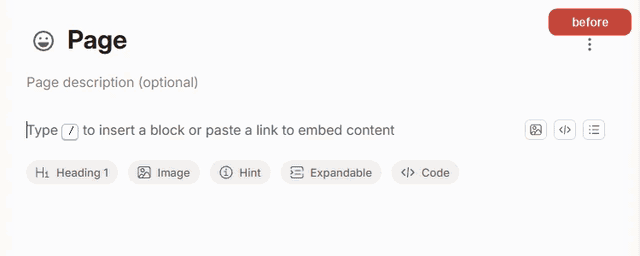
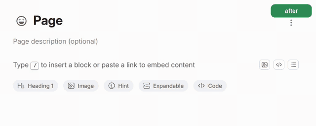
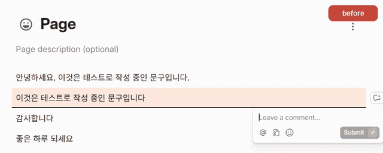
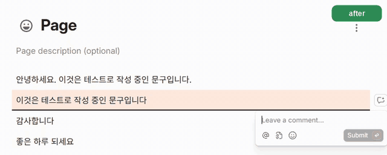

# gitbook-hangul-ime-fix

GitBook 편집기에서 한글 IME로 입력할 때 스페이스·줄바꿈이 사라지거나 글자가 깨지는 문제를 우회하는 유저스크립트입니다. 본문과 블록 코멘트 입력창에서 동작합니다.

## 해결하는 문제

| 위치 | 증상 |
|---|---|
| 본문 | 줄 중간·앞쪽에서 스페이스·Enter가 사라지거나("바 사 " → "바사 ") 글자가 엉뚱한 위치에 들어감 |
| 코멘트 입력창 | 입력 후 커서를 앞으로 옮겨 추가 입력하면 글자가 낱자로 깨지고("요" → "ㅛ") 순서가 뒤섞임 |

원인은 GitBook 편집기(구버전 Slate)입니다. 확장 프로그램·맞춤법 검사·IME 버전·브라우저를 바꿔도 해결되지 않습니다. 근거는 [docs/attempts.md](docs/attempts.md)에 있습니다.

아래는 같은 키 입력(실제 한글 IME 입력)의 결과입니다.

### 본문

입력: 첫 줄은 그대로 입력합니다. 둘째 줄은 `이것은 문구입니다` 직후 `Home`으로 앞에 `테스트로 작성 중인 `을 끼워 넣습니다. 셋째 줄은 `감사합니다` 직후 Enter를 누릅니다.

### 코멘트 입력창

입력: `이것은 문구입니다` 직후 `Home`으로 앞에 `코멘트로 작성 중인 `을 끼워 넣습니다.

## 설치

1. 유저스크립트 관리자 Tampermonkey를 설치합니다: [Chrome](https://chromewebstore.google.com/detail/dhdgffkkebhmkfjojejmpbldmpobfkfo) · [Firefox](https://addons.mozilla.org/firefox/addon/tampermonkey/)
2. **Chrome만**: `chrome://extensions`에서 Tampermonkey의 "세부정보"를 열고 "사용자 스크립트 허용"을 켭니다. 꺼져 있으면 스크립트가 실행되지 않습니다. ([안내](https://www.tampermonkey.net/faq.php?q=Q209))
3. **[설치하기](https://raw.githubusercontent.com/yimsemin/gitbook-hangul-ime-fix/main/gitbook-hangul-ime-fix.user.js)**를 열고 Tampermonkey 화면에서 "설치"를 누릅니다.
4. GitBook 편집기 탭을 새로 고칩니다. 입력기는 평소처럼 한글로 씁니다.

## 업데이트

- 자동: 위 링크로 설치하면 Tampermonkey가 하루 한 번 최신 버전을 확인해 업데이트합니다.
- 바로 받기: Tampermonkey 대시보드에서 이 스크립트를 열고 "업데이트 확인"을 누릅니다. 새 버전이 올라온 뒤 반영까지 몇 분 걸릴 수 있습니다.

## 동작 방식

OS 한글 IME는 그대로 두고, 페이지에서 편집기 객체를 찾아 내부 상태를 보정합니다.

- 조합이 끝났는데 편집기가 아직 조합 중으로 여기면 상태를 풀어, 스페이스·Enter를 처리하게 합니다.
- 조합 직후 커서를 옮기면 편집기 커서를 화면 커서에 맞춥니다.
- 코멘트 입력창이 조합 중인 글자를 덮어쓰지 못하게 막고, 화면이 늦게 갱신되면 편집기 커서 위치에 글자를 넣습니다.

## 범위와 한계

- 대상: `https://app.gitbook.com/*`의 본문과 코멘트 입력창. 다른 사이트, GitBook 공개 문서 화면, 일본어·중국어 IME는 다루지 않습니다.
- 확인한 환경: Windows 11, Chrome, Tampermonkey, Microsoft 한글 IME. Firefox와 Violentmonkey는 확인하지 않았습니다.
- GitBook 내부 구조(구버전 Slate, React 내부 속성)에 기대므로 GitBook 업데이트로 깨질 수 있습니다. 편집기 객체를 찾지 못하면 아무것도 하지 않습니다.

## 성공 기준과 결과

실제 IME 입력으로 실행했을 때 입력한 문자열과 결과가 같아야 합니다.

| # | 시나리오 | 기대 결과 | 결과 |
|---|---|---|---|
| 1 | 본문, 줄 끝 입력 | 입력한 그대로 | 통과 |
| 2 | 본문, 줄 중간에 "바 사 " 입력 | 스페이스 2개가 모두 남음 | 통과 |
| 3 | 본문, 조합 중 방향키·Home·클릭으로 커서 이동 | 조합 글자가 깨지지 않고 이동한 위치에 이어서 입력됨 | 통과(클릭은 미시험) |
| 4 | 코멘트 입력창, 입력 후 커서를 앞으로 옮겨 추가 입력 | 새 글자가 커서 위치에 순서대로 들어감 | 통과 |

시험 방법과 미시험 항목은 [docs/attempts.md](docs/attempts.md)에 있습니다.

## 문제 신고

동작이 깨졌거나 다른 환경에서 증상이 나타나면 [Issues](https://github.com/yimsemin/gitbook-hangul-ime-fix/issues)에 사용 환경(운영체제, 브라우저, 한글 입력기)과 증상을 적어 주세요.

## 저장소 구성

- [gitbook-hangul-ime-fix.user.js](gitbook-hangul-ime-fix.user.js): 유저스크립트 본체
- [docs/attempts.md](docs/attempts.md): 원인, 시도별 결과, 시험 방법, 배포와 버전
- [tools/ime-send-keys.ps1](tools/ime-send-keys.ps1): 실제 IME 키 입력을 보내는 시험 도구(Windows 전용)
- `docs/media/`: 이 문서의 GIF

## 라이선스

[MIT](LICENSE)
